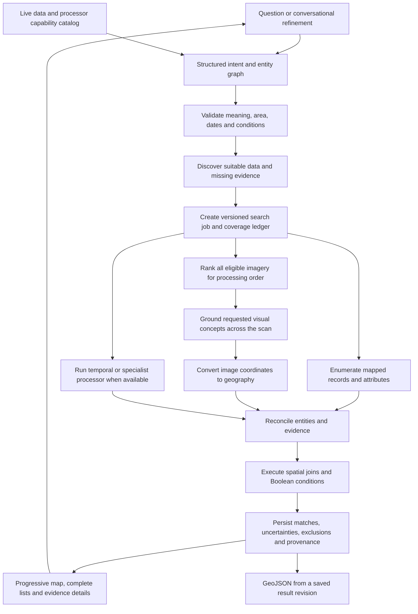

# GEOAI 05 — Multimodal GeoAI Query Engine

## 1. Purpose and product promise

A user describes **what they want to find, where they want to find it, and any conditions it must satisfy**. The engine searches available geographic records and imagery, checks the requested relationships, and returns inspectable locations on a map with a complete downloadable result set.

The user should not need to know whether the answer comes from a building footprint, an image model, a road attribute, a spatial join, or several of these together.

**Product promise:** “Describe what you need. See every matching record and plausible candidate found in the selected area, inspect the evidence, and export the results.”

“Every” applies to the declared data, search area, dates, processing coverage and detection policy. It cannot mean guaranteed discovery of every real-world object. Missing imagery, unmapped infrastructure, occlusion and model mistakes remain possible. The application must reveal these gaps instead of hiding results or implying certainty.

**Status:** This is the revised target workflow and pipeline, updated 9 October 2026. Implementation now includes dynamic catalog discovery, structured multi-entity plans, durable concurrent search jobs, complete saved result revisions, query-driven grounding, spatial evidence checks and API export. The [backend implementation guide](docs/backend-pipeline.md) records the delivered interfaces, verification and remaining capability limits. This document remains the full product target; implemented capability must be checked against that guide.

## 2. Why someone would use it

Users usually start with a decision, not a map layer. They want to know where to inspect, what to investigate, or which places satisfy a combination of conditions.

| User | Question behind the search | What the engine must deliver | Practical value |
| --- | --- | --- | --- |
| Municipal planner | Which infrastructure locations satisfy my planning criteria? | All discovered qualifying features, the conditions checked, source dates and missing information | A defensible shortlist for planning and field verification |
| Field assessor | Where should I visit, and what should I verify there? | Coordinates, visible evidence, uncertain attributes and an exportable inspection list | Less time scanning imagery and fewer visits based on ambiguous findings |
| Drainage or utility team | Which assets are close to drains, waterways or other infrastructure? | Asset geometries, relevant reference features and measured relationships | Faster identification of locations requiring assessment |
| Environmental analyst | Where do roads overlap suspected clearing or other land-cover patterns? | Road and patch evidence; paired observations when the question claims change | Focused investigation with a clear distinction between appearance and change |
| Rescue coordinator | Which locations may need attention in a mapped incident area? | Relevant features, observation times, coverage gaps and available incident evidence | Situational discovery; current access or safety still needs current supporting data |
| Resident or general user | Where is this place, or where are objects matching my description? | Relevant mapped places, visual candidates and readable explanations | One search interface without learning GIS tools |

These are examples of user needs, not a fixed list of supported users, places or objects.

A map lookup can answer “Where is this college?” The central GEOAI requirement is more demanding: “Which objects have this visible property **and** satisfy this geographic relationship?” The useful unit of output is an object or location with evidence for each required condition.

For example, “commercial roofs with solar installations within 200 metres of open drainage” combines visual identification, building identity, a business-use attribute, drain classification and a distance calculation. Showing a tile that contains some buildings and a drain does not answer that question.

Success means the user can move from a question to a reviewable geographic result set, understand why each item appeared, and carry that same evidence into another GIS tool or a field assessment.

## 3. No hardcoding: mandatory design rules

The engine must operate from user input, discovered data, provider metadata and versioned configuration. Moving a fixed whitelist into a configuration file alone does not create an open search engine.

| Area | Required behavior | Behavior to remove or prevent |
| --- | --- | --- |
| Geography | Resolve the user's place, administrative boundary, coordinates or drawn area dynamically | Fixed cities, coordinates, default demonstration locations or silent geographic substitution |
| Search extent | Use the requested area; partition large areas into resumable work | Replacing an entire municipality with an arbitrary circle around its centre |
| Language | Build a structured plan from the full query and conversation | Recognizing only prepared sentences, keywords or radius templates |
| Objects | Accept new visual descriptions; discover relevant mapped concepts from actual schemas and metadata | A closed menu of roofs, pools, roads or other preselected classes |
| Attributes | Ground mappings in available source fields, tag documentation or configured authoritative records | Guessing an attribute from appearance or a fixed keyword rule |
| Imagery | Select usable assets by footprint, date, resolution, access and task suitability | Always using one prepared bundle or a named sample city |
| Models | Choose installed, compatible models through a capability registry | Returning cached results for a different prompt or pretending every concept is supported |
| Thresholds | Use versioned, source-appropriate policies; label unvalidated settings | Universal unexplained similarity or detector cutoffs presented as confidence |
| Results | Persist all produced results before display pagination | Fixed top-10 or top-100 output/export limits |
| Follow-ups | Apply a validated change to the previous plan | Special-case string replacements that lose earlier conditions |
| Answers | Generate summaries from executed results and source evidence | Seeded answers, invented detections or fabricated result counts |

Generic software rules remain necessary: typed contracts, validated spatial operators, finite coordinates, access controls, and declared resource budgets. These protect execution; they must not become hidden restrictions on places or concepts.

A new dataset or provider can require an adapter. Once it implements the common contract, adding a new area or object concept must not require editing the central router or adding a new query-specific branch.

“No hardcoding” does not imply that any model can identify anything. It means unsupported requests receive a capability check and a truthful explanation, rather than being rejected solely because their words are absent from a fixed list.

## 4. What users can ask

The same search box supports multiple intent types. A compound question may activate several paths together.

| Intent | Illustrative question | Evidence and processing needed |
| --- | --- | --- |
| Named location | “Find the college called X in this district.” | Place index, identity resolution and all returned plausible identities |
| Mapped category | “Show hospitals in this municipality.” | Category-to-schema mapping and enumeration of actual records across the boundary |
| Visible object | “Find rooftop solar arrays.” | Suitable imagery and text-conditioned object grounding |
| Scene or pattern | “Find densely built neighbourhoods.” | Image–text retrieval over all eligible tiles; scene footprints |
| Source attribute | “Show unpaved roads.” | Attributable surface records, or separately labelled visual inference where feasible |
| Spatial relationship | “Find buildings within 200 metres of drains.” | Subject/reference geometry and a metric spatial predicate |
| Compound condition | “Find commercial roofs with panels near open drains.” | Several evidence paths linked to the same entities; explicit distance required |
| Boolean condition | “Find schools or clinics outside the flood area.” | Grouped AND/OR/NOT conditions and suitable flood-layer provenance |
| Count or measure | “How many matching buildings are in each ward?” | Deduplicated results and administrative geometries; area-normalized coverage reporting |
| Change over time | “Find forest cleared between these dates.” | Registered before/after data and validated change processing |
| Conversational refinement | “Only the eastern ward; increase the distance.” | A plan revision preserving every unchanged condition |

These examples are acceptance scenarios, not templates required for execution. Any new concept follows the same planning and evidence process.

Legal status, ownership, occupancy, current road passability, underground utilities and historical change cannot be established from an ordinary single-date RGB image alone. Search relevant records if connected; otherwise mark the missing condition. A visible bare patch is not automatically a cleared forest, and a large roof is not automatically commercial.

## 5. End-to-end user workflow

### Step 1 — Establish the search area and observation period

The user can name an area in the query, draw a boundary, supply coordinates with a radius, or use an explicitly selected area from the conversation.

Resolve administrative names to their actual boundary where available. Display plausible choices when identity is ambiguous. Do not silently select the first geocoder result or turn a place label into an arbitrary search radius.

If the user provides no location, use the clearly displayed active search area. If none exists, ask for one. “Search all loaded data” is also a valid scope. The map viewport becomes the search area only through an explicit “Search this area” action.

Display imagery dates, vector snapshot dates, usable coverage and unknown dates. “Latest available” means the newest suitable evidence found in the connected sources; it does not mean live conditions.

### Step 2 — Interpret the entire question

Translate the question into an editable plain-language interpretation, for example:

> Find buildings classified as commercial, with solar installations associated with their roofs, whose footprints are at most 200 metres from a drain supported as open, inside the selected municipality.

Preserve objects, attributes, locations, units, relationships, Boolean grouping, time constraints and requested output. Ask only for ambiguity that changes the answer, such as the intended place, the meaning of “near,” or a missing comparison date. Independent data discovery may continue while clarification is pending.

### Step 3 — Discover evidence and show feasibility

Inspect the data catalog and available processors for every clause. Report whether it can be checked from mapped records, imagery, additional records, temporal evidence or a combination.

If an attribute is missing, continue the portions that can be evaluated and show plausible candidates as incomplete evidence. Do not remove the missing clause or relabel those candidates as full matches.

If suitable imagery is unavailable, show the coverage gap and available data choices. A satellite catalog footprint is an available image asset, not an object detection. Do not run the query over another city.

### Step 4 — Start one search and show progressive results

The default workflow is a scan of the declared scope. Show the earliest available mapped results and visual candidates while the remaining eligible data is processed.

Progress describes actual work: area covered, tiles processed, unresolved partitions and source failures. Early results are explicitly provisional. The system continues beyond the highest-ranked tiles instead of treating the first page as the final answer.

If the user deliberately requests a quick preview, label it as a partial search and offer continuation over the remaining scope. Resource limits may pause a job; they must not silently shrink the area or report completion.

### Step 5 — Inspect all result groups

Present the following groups with separate counts, map layers and accessible lists:

| Result group | Meaning |
| --- | --- |
| Matches | All required conditions pass under the recorded evidence policy |
| Needs review | A plausible subject exists and the full condition expression is unresolved |
| Visual candidates | Relevant scenes or grounded observations without sufficient object-level evidence for the full question |
| Related results | Explicitly labelled results from a separately recorded relaxation or alternate interpretation |
| Coverage gaps | Areas or conditions that could not be assessed; these are not objects |

For a pure scene-search query, the requested scene results can be complete at the tile level; that does not turn them into object detections. Grounded model matches still carry their model-derived status unless a human has reviewed them.

Show all groups by default with clear visual distinctions. A failed condition excludes an item from the full-match group. Evaluated exclusions remain inspectable with their reasons; they should not flood the map as supposed matches.

### Step 6 — Review the evidence for a location

Selecting a result opens its original image crop if available, object box or geometry, relevant map features, per-condition decisions, distances, dates and source links.

A user should be able to answer: “What is this? Where is it? Why did it qualify? What is still uncertain?”

### Step 7 — Refine conversationally

A follow-up modifies the stored plan: area, distance, concept, date, condition, sorting or display filters. Show the change and preserve all other clauses. Widening a distance or area may require additional source acquisition and processing; recompute from the relevant underlying evidence rather than filtering only the old matches.

### Step 8 — Export the same search

Export all results for the chosen groups from the saved run revision, regardless of the current map viewport or list page. Include geometry, per-condition evidence, dates, source attribution, uncertainty and scope metadata.

An export during processing is a labelled partial snapshot with completed and pending coverage. A completed export must include every stored eligible result in that revision. Export must not rerun a changing external provider or silently return a different dataset.

## 6. Pipeline architecture

The language model interprets the request. Vision models produce visual evidence. GIS code evaluates geometry. The result store supplies the final answer. No model-generated sentence is treated as an executed measurement.

The three core paths are complementary. A mapped search should work without imagery when the question only needs map records. A visual search should retain unmapped detections. A compound search must combine evidence instead of forcing the entire question into one exclusive route.

## 7. Data discovery and preparation

### 7.1 A runtime catalog replaces fixed sample selection

Register local imagery, uploaded or administrator-added datasets, OSM extracts and connected provider assets through a common catalog. Provider access and bulk acquisition follow their configured service constraints.

For each asset or layer, retain:

- Stable ID, source URI, version or checksum, acquisition/snapshot time and retrieval time.
- Actual footprint, valid-data mask, coordinate reference system and available geographic transform.
- Resolution, sensor/bands, image dimensions, cloud/no-data information and known positional uncertainty.
- Vector schema, observed fields and values, geometry types, source IDs and completeness information where known.
- Access availability, processing/reuse rights, attribution and operational limits.

Discover suitability from this metadata and an actual readability check. Geographic intersection alone is insufficient. A source may cover the area but lack the detail, date, bands or alignment needed for the requested concept.

Track imagery coverage and reference-layer coverage separately. For proximity checks, acquire references beyond the subject area by the requested distance and justified positional margin. An object near the municipal border may qualify because of a drain just outside that border.

### 7.2 Roles of the challenge references

[SkyScript's official repository](https://github.com/wangzhecheng/SkyScript) provides remote-sensing image–text data, metadata and SkyCLIP checkpoints. Use these for retrieval development and model initialization. Its crops span sources and locations; a downloaded subset must be checked for geographic continuity and appropriate resolution. Captions derived from OSM are source annotations, not independent detector ground truth. The repository's software licence is not a universal licence for every underlying image source.

[SpaceNet 1](https://spacenet.ai/spacenet-buildings-dataset-v1/) supplies Rio imagery and building-footprint training labels, making it useful for building extraction and geometry association checks. It does not establish the complete solar/commercial/open-drain example. Keep supplied labels separate from model predictions, and retain the published dataset attribution and licence.

Neither reference is the product's fixed search geography or object vocabulary. A target municipality requires its own usable imagery and corresponding vector coverage.

### 7.3 Prepare reusable geographic evidence

1. Validate source geometry and georeferencing; preserve originals and record repairs.
2. Partition the actual area into work units with overlapping image windows and valid-data masks. Choose window scale from source resolution, model input constraints and target size; record the policy.
3. Create image embeddings for full scenes and suitable smaller crops. Preserve the exact mapping from each embedding to its source footprint.
4. Retain vectors and attributes at their source fidelity; build spatial and attribute indexes.
5. Cache reusable visual observations where justified. A cache is an acceleration layer, not the list of concepts users may request.
6. Record prepared, missing, failed and unsuitable coverage separately. Do not count overlapping image windows twice when measuring geographic coverage.

Preprocessing and model versions must travel with each artifact so compatible evidence can be reused and stale evidence can be recomputed.

## 8. Query planning without fixed templates

### 8.1 Represent the request as a graph

A single `concept + reference + radius` structure is insufficient for arbitrary compound questions. The plan needs multiple entities and relationships.

| Plan component | Required information |
| --- | --- |
| Scope | User's area, resolved geometry, temporal constraints and geometry inclusion rule |
| Entities | Subject, reference and contextual entities; original descriptions and source-backed concept mappings |
| Conditions | Visual, attribute, spatial and temporal clauses with their original text spans |
| Relationships | Which specific entities are related, direction, units, geometry roles and quantifiers |
| Boolean expression | Explicit nesting of AND, OR and NOT; no loss of parentheses or negation |
| Evidence requirements | Acceptable sources and processors for each clause; unknown or unavailable dependencies |
| Output | Objects, scenes, counts, statistics, sort order and selected evidence groups |
| Execution policy | Complete scan or explicit preview; threshold-policy version, resource budget and resume state |
| Conversation state | Parent plan ID, validated modifications and version |

The plan should distinguish “one drain satisfies both conditions” from “different drains satisfy different conditions,” and “near any road” from “near every road.” The join structure must preserve these meanings.

### 8.2 Resolve concepts against actual data

Retrieve candidate meanings from the selected layers' schemas, observed tags, metadata and maintained source documentation. Combine these with the original visual description to propose source-backed mappings.

If several mappings would change the meaning, expose the ambiguity. Missing fields remain unknown. Visual concepts do not require an exact OSM category, and OSM categories do not require a matching image-detection label.

Prompt expansions and synonyms may improve retrieval, but retain the original clause and check the final results against it. Expanding “open drainage” to “river” or “commercial” to “large building” changes the question and requires a separately labelled alternative.

### 8.3 Validate and compile

Use schema-constrained language interpretation plus server validation. Every meaningful clause must appear in the executable plan, a clarification request or an explicit unsupported condition. Handle parser uncertainty, refusal, timeouts and malformed output as such.

Compile the plan to a finite registry of tested operations with declared argument types, geometry requirements and evidence prerequisites. Operators can be extended through the registry; arbitrary model-generated SQL, Python, file paths or coordinates are not execution instructions.

The system can use a configured local or hosted parser. Without a capable interpreter, offer a structured query builder and preserve the original request. Do not claim unrestricted natural-language support through a few fallback expressions.

## 9. Retrieval and grounding without hidden omissions

### 9.1 Start from all relevant evidence paths

Enumerate relevant mapped entities across the declared area. Independently scan imagery for visible objects that may be absent from the map. Union these candidates and preserve their origin before reconciliation.

Do not require an OSM footprint before searching for a visible building or solar installation. Do not require an image detection before returning a record-only answer to a record-only question.

A named-place geocoder is useful for identity resolution. Its ranked suggestions are not a complete inventory of all facilities in an area. Category enumeration needs a source that supports complete extraction or pagination; otherwise report the unenumerated portion as unknown.

### 9.2 Use image similarity to order work

Use compatible text and image encoders from the same selected model and preprocessing configuration. [OpenCLIP](https://github.com/mlfoundations/open_clip) documents the image/text encoding and similarity workflow.

Score all eligible indexed scenes or crops in the declared scope. Use similarity to prioritize likely locations and rank scene-search output. In a complete object scan, low similarity alone must not discard an otherwise eligible image before grounding.

For larger indexes, an approximate nearest-neighbour index can support a preview. A complete scan needs full enumeration or an explicitly measured and disclosed retrieval limitation. Increasing top-k without accounting for the remainder does not establish completeness.

Pure scene search exposes all ranked eligible tiles through pagination. Separate recommended scenes from lower-relevance scenes, and make any screening cutoff visible. Similarity is a ranking signal, not a probability that a described object exists.

### 9.3 Ground the user's visual concepts

Select an installed open grounding model through the processor registry. The initial implementation can use the existing OWLv2 integration; the architecture must permit another compatible processor without rewriting user intent logic. [OWLv2 documentation](https://huggingface.co/docs/transformers/model_doc/owlv2) describes text-conditioned boxes and postprocessing; this does not establish accuracy on local aerial imagery.

For an uncached visual concept, run actual inference with the validated prompt over every eligible window in the declared complete scan. Use retrieval order for early results, retain small-object detail, and account for overlap at image boundaries.

Cache keys must include imagery/version, crop transform, model/processor version, exact prompt set and output policy. Never substitute results from a similar but different concept.

Persist produced observations with raw scores, original pixel coordinates, acquisition dates and inference provenance. Screening and suppression policies must be explicit and versioned. Preserve reviewable lower-score candidates according to that policy and record discarded-output counts/reasons where available. Internal model limits and false negatives remain limitations even after every tile has been processed.

Unknown concept performance is labelled unvalidated. If the worker is unavailable, return available scene candidates with “grounding pending/unavailable”; do not relabel them as located objects.

### 9.4 Use geometry suitable for the requested claim

Boxes support approximate object location. Exact patch boundaries, road surface extent and forest-change intersections may require an appropriate segmentation or temporal processor.

Choose such a processor only when its prerequisites are met. A mask needs its own validation; adding segmentation does not make it ground truth. If only a coarse box exists, retain the candidate and mark boundary-dependent claims unresolved.

## 10. Geographic conversion, identity and joins

### 10.1 Convert observations correctly

Map detector coordinates back to the original image window, accounting for resize or padding exactly once. Transform all corners using the window's transform, or add the window offset once and use the parent transform. Preserve rotated quadrilaterals where applicable. The transform mechanisms are described in [Rasterio's documentation](https://rasterio.readthedocs.io/en/stable/topics/transforms.html).

A scene without reliable georeferencing can be shown as imagery but cannot receive an invented precise object coordinate. The bounding box of a whole tile must not be presented as the box of a detected object.

### 10.2 Link evidence to the right entity

Maintain distinct records for an observation, a physical-entity candidate, a mapped feature and a spatial relationship.

For rooftop panels, associate the panel observation with a particular building using geometry, image/map registration and a validated association policy. If several buildings are plausible, preserve the ambiguity. Panels on building A cannot establish that nearby commercial building B has solar panels.

Deduplicate overlapping observations conservatively using source identity, geometry, concept and time. Preserve all supporting observations. Do not merge neighbouring objects solely because broad detection boxes overlap, or merge different dates into one timeless observation.

Where there is no mapped counterpart, retain the visual object with its own geometry and unknown mapped attributes. Uncertain deduplication affects counts and must remain visible.

### 10.3 Execute deterministic spatial conditions

Use a suitable local metric projection for a bounded area, or an appropriate geodesic method for wider extents. Never interpret a longitude/latitude buffer as metres. GeoPandas operations are planar, as documented in [its spatial join reference](https://geopandas.org/en/stable/docs/reference/api/geopandas.sjoin.html).

| Relationship | Execution rule |
| --- | --- |
| Within a distance | Minimum distance between the declared subject and reference geometries is less than or equal to the requested distance |
| Intersects | Evaluate the actual geometries; boundary contact counts unless the plan explicitly requires an interior crossing |
| Inside/outside | Use the declared containment/boundary rule; distinguish geometric outside from missing data |
| Nearest | Define the distance metric, reference universe, tie policy and available reference coverage |
| Between/connected/reachable | Execute only if a defined operator and suitable geometry or network data are available |
| Change | Compare suitable dated observations; a single image cannot establish a transition |

Spatial indexes select possible pairs; exact predicates decide the relationship. Preserve all qualifying reference links, even if the card shows only the nearest witness. Do not replace “all features within the radius” with a nearest-neighbour lookup.

Keep the subject geometry, detection geometry and reference geometry separate. A road centreline is not its full physical surface. A building footprint is not necessarily the roof edge. State which geometry was used.

If registration or boundary uncertainty could change a threshold decision, mark it for review. Any assumed positional allowance must be labelled as an assumption; it is not a calibrated confidence interval.

### 10.4 Evaluate conditions with three-valued logic

Each clause returns `pass`, `fail` or `unknown`, plus evidence and a reason. Apply the complete Boolean expression:

- AND passes only when all operands pass; any failure makes it fail; otherwise it is unknown.
- OR passes when at least one operand passes; it fails only when all fail; otherwise it is unknown.
- NOT reverses pass/fail and preserves unknown.

A missing OSM tag is unknown. Detector non-detection is not evidence of absence. Claims such as “buildings without panels” or “no drain nearby” require adequate observation/reference coverage and a justified absence policy; otherwise retain unknown.

## 11. What “all possible results visible” requires

### 11.1 Separate three kinds of completeness

| Dimension | Question answered |
| --- | --- |
| Data coverage | Does usable imagery and required reference evidence cover the requested area and dates? |
| Processing coverage | Has every planned eligible work unit been processed or explicitly accounted for? |
| Result accessibility | Can the user inspect and export every stored result and candidate in this run? |

A complete scan of available imagery does not establish complete municipal data coverage or perfect detection recall. A complete cached-catalog scan does not mean a new concept has been searched in every image.

Compute geographic coverage from the union of usable footprints clipped to the requested area. Track coverage per required evidence layer and their usable intersection. Tile counts alone are insufficient when windows overlap or have different sizes.

### 11.2 Enumeration and persistence rules

1. Partition large areas and exhaust provider pagination or extraction units, retaining a stable snapshot where supported.
2. Where snapshot consistency cannot be guaranteed, record per-partition versions/times and disclose the inconsistency.
3. Fetch reference margins and retain complete needed geometries across partition edges.
4. In a complete visual scan, process every eligible window under the declared inference policy. Record failures, unsuitable data and unprocessed units.
5. Use only conservative pruning that cannot eliminate a potentially qualifying entity under the plan's evidence rules. Unknown evidence cannot be treated as a negative for pruning.
6. Persist every generated match, review candidate and evaluation record before slicing a display page.
7. Deduplicate at entity level while preserving evidence links and ambiguous identities.
8. Page and sort the stored result set using stable IDs and a revision-bound cursor.
9. Export from that same stored revision, independent of display limits.
10. If a provider returns a cap, timeout, partial geometry or non-pageable ranked subset, mark the search partial or coverage unknown. Do not infer that its last returned record is the last available result.

Do not bypass provider quotas to promise completion. Use permitted extracts, supported pagination, configured services or resumable jobs; expose a blocked source when none can enumerate the requested scope.

### 11.3 Map and list behavior

The map represents the complete stored result set through clusters, tiles or spatially paged layers. The result list may be virtualized or paginated, but map markers cannot be drawn only from the current list page.

Cluster counts refer to unique entities in the selected result groups and run revision. Zooming or opening a cluster exposes its members. Distinct objects at identical coordinates remain accessible in a list. Offscreen results remain reachable through “Fit all results” and the complete list.

Changing the viewport does not rerun or narrow the search. Display filters show both the filtered count and total available count. The user can reveal every group without rerunning inference.

Statistics and counts use all persisted relevant results, not the loaded page. While processing continues, show “found so far,” not a final total. Counts refer to recorded entities and may still depend on detection recall and identity uncertainty.

### 11.4 A coverage ledger accompanies every run

Store the requested area and dates, available/suitable/processed/unprocessed footprints, source enumeration state, work-unit status, result-group counts, known exclusions, threshold policy, operational pauses and remaining work.

Allowed job states include waiting for clarification, queued, running, partial, paused, completed, failed and cancelled. “Completed” means the declared execution plan finished; data coverage and visual reliability are separate fields. A job with unresolved execution failures must not claim a successfully completed full scan.

An empty response must explain whether there were no supported matches, no usable data, unresolved conditions, no model findings, or an incomplete scan. These outcomes are not interchangeable.

## 12. Result and export contract

Each result must carry enough information to reproduce its explanation:

| Field group | Required content |
| --- | --- |
| Identity | Run/revision ID, stable entity/result ID, entity type and evidence group |
| Geometry | Best-supported geometry, geometry role, bounding box and a labelled map location |
| Visual evidence | Source image/crop, observation geometry, prompt, model version, raw score and review status |
| Map evidence | Source feature IDs, relevant attributes, geometry and snapshot date |
| Condition decisions | Clause ID, pass/fail/unknown, reason and linked evidence |
| Relationships | All qualifying reference IDs, measured values, units, predicate and analysis method |
| Provenance | Dataset versions, observation dates, retrieval/inference times, attribution and source links |
| Limitations | Missing attributes, ambiguous association, coarse boundaries, temporal mismatch or incomplete coverage |

Scene results use scene footprints. Object results use the best available object or associated-feature geometry with its role declared. Representative points are navigation aids, not substitutes for physical boundaries.

Export a GeoJSON `FeatureCollection` with WGS84 longitude/latitude coordinates, stable feature IDs and per-feature properties. Keep subject, observation, reference and coverage features distinguishable through a `feature_role` and linking IDs. GeoJSON coordinate order and format follow [RFC 7946](https://www.rfc-editor.org/info/rfc7946/).

Include run-level plan, scope, counts, completion/coverage state and version metadata as documented collection metadata; repeat essential status and provenance in feature properties for GIS tools that ignore collection extensions. Export an empty collection with explanatory metadata when no features exist.

Default export includes matches and review candidates, clearly labelled. Let the user include scene candidates, related results and reference/coverage context or request matches only. State the selected groups and counts before download. Very large exports may be streamed or built as a background artifact; they must not silently lose records.

## 13. Runtime components and job lifecycle

Retain suitable existing components while changing their contracts where necessary.

| Component | Responsibility |
| --- | --- |
| Conversational map UI | Query, scope interpretation, progress, complete result groups and evidence inspection |
| API/orchestrator | Validated plans, job creation, retries, progress and saved revisions |
| Data/provider catalog | Runtime source discovery, schemas, geographic coverage, availability and provenance |
| Model/processor registry | Installed model capabilities, versions, input requirements and local evaluation status |
| Retrieval and inference workers | Image/text encoding, dynamic grounding and optional specialist processing |
| Spatial executor | Coordinate conversion, association, geometry operations and condition evaluation |
| Persistent result store | Plans, work units, evidence, all results, revisions and exports |

The existing FastAPI, MapLibre, OpenCLIP/SkyCLIP, OWLv2, Rasterio, GeoPandas and Shapely components are reasonable starting points. Backend libraries are implementation choices; users interact with geographic meaning and evidence.

Prepare embeddings and reusable evidence ahead of time. Execute text interpretation, uncached grounding, joins and refinements as required by each request. Every cache entry is versioned; source, prompt, transform or model changes invalidate affected entries.

Move long scans out of a single HTTP request. The API creates a job and exposes progress, result pages, map data and an immutable export revision. Use bounded queues, persisted checkpoints and idempotent work units so interruption does not lose completed work or create duplicates.

Resource budgets are configured operational policies, separate from query meaning. When a budget is reached, preserve results, mark the remainder pending and offer continuation or an explicitly chosen narrower scope. No fixed cap may masquerade as the complete answer.

## 14. Changes required from the existing prototype

Repository inspection shows useful foundations: named-place discovery, mapped spatial queries, registered imagery bundles, SkyCLIP retrieval, OWLv2 evidence, spatial execution and GeoJSON export. The existing repository workflow describes these implementation paths in [backend implementation guide](docs/backend-pipeline.md).

The current implementation also contains restrictions inconsistent with this target. The following are required changes, not changes completed by this document:

| Current pattern | Required replacement |
| --- | --- |
| Fixed supported mapped-layer vocabulary and conservative keyword routing | Schema-grounded entity resolution and a validated multi-entity plan |
| A mapped search sampled around a resolved place with a fixed local radius | The user's actual area, partitioned for complete processing |
| Fixed result truncation before the full set is available to the user | Persist all results, then paginate map/list delivery and export all selected groups |
| Ranked place suggestions used as a bounded lookup | Preserve ambiguity; use enumerating sources for complete area-category searches |
| Prepared sample bundles as the available visual search universe | Discoverable data catalog with explicit coverage and source-suitability checks |
| Cached concept availability shaping what can be grounded | Query-specific inference for uncached descriptions, with capability and quality status |
| Limited single-relation plans and special follow-up handling | Entity/relationship graph, Boolean semantics and versioned plan patches |
| Separate evidence paths chosen as mutually exclusive routes | A planner that combines relevant map, visual, attribute and temporal subqueries |
| Saved exports preserving only a capped discovery response | Saved exports preserving the entire persisted result revision |

Preserve existing changes and working evidence paths during implementation. Do not overwrite real results with fixture data or relabel existing samples as coverage of a newly requested area.

## 15. Delivery order

1. **Fix scope and result completeness.** Introduce persistent runs, complete record storage, pagination, full map representation and saved exports. Remove silent truncation and geographic substitution.
2. **Introduce the data and capability catalogs.** Discover available areas, schemas, imagery and processors; expose missing dependencies.
3. **Replace narrow routing with structured planning.** Support open descriptions, compound conditions and conversational revisions while preserving every clause.
4. **Make visual grounding query-driven.** Reuse compatible caches, process uncached descriptions, and continue through all eligible imagery in a complete scan.
5. **Strengthen association and spatial evidence.** Preserve entity identity, every relevant reference, boundary semantics and unknown states.
6. **Validate the complete user journey.** Use real, unseen queries and independently reviewed data, including missing-data and large-result cases.
7. **Add specialist capability where evidence supports it.** Temporal change, segmentation and network analysis enter through the same processor contracts. Their absence must already have a truthful workflow.

The first end-to-end release should work on at least one real, bounded area while accepting arbitrary user descriptions through capability discovery. Its supported data and reliable visual concepts may initially be limited; its search architecture and result access must not depend on those particular examples.

## 16. Acceptance and evaluation

### Functional acceptance

| Scenario | Required outcome |
| --- | --- |
| A new municipality and dataset are added | The catalog discovers their scope and fields without a place-specific router change |
| A user asks for a visual concept absent from cached detections | Suitable live inference runs, or the UI clearly shows scene candidates and the missing capability |
| A municipality is larger than one provider request | The job partitions the actual boundary and accounts for every partition |
| The result set exceeds a page or previous cap | Every stored result is accessible on the map/list and present in the selected export |
| A relevant object occurs in a low-ranked tile | A complete scan still processes that tile and can return the object |
| An object is unmapped or lies at a tile boundary | Visual search and overlap handling retain it; missing map attributes remain unknown |
| A reference lies just outside the subject area | Proximity uses the declared external reference margin |
| Several references qualify | All relationship links are retained; the subject is not accidentally counted once per reference |
| A named place has several plausible identities | Candidates remain visible and dependent spatial execution awaits resolution |
| One required attribute is missing | The full query remains intact and the result is classified by its Boolean evidence state |
| The query contains AND, OR, NOT or multiple entities | Grouping, identity and unknown propagation remain correct |
| A negative query receives no detector response | Absence is not asserted without adequate evidence |
| A provider times out or truncates data | Completed work is preserved; unresolved coverage and continuation are explicit |
| A user pans the map or loads another page | Query scope, global counts and export membership remain unchanged |
| A user widens the search in a follow-up | Newly relevant data is evaluated, not just the previous matches |
| A user exports a saved run after sources change | Export preserves the selected saved revision |
| Only single-date imagery exists for a change question | Historical change remains unresolved; current appearance is labelled separately |
| All available work is finished but no match is supported | The response reports the checked scope and evidence limits instead of asserting real-world absence |

### Quality measurements

Measure query interpretation and clause preservation, object/relationship precision and recall, association errors, coordinate/overlay error, missed partition/edge results, deduplication errors, completion coverage, time to first result, time to finish, and export/result-set equality.

Evaluate on geographically separated, independently annotated examples with positives, negatives, small objects, ambiguous attributes, missing layers and boundary cases. OSM-derived captions and matching OSM tags do not independently validate visual recognition. Keep model predictions separate from supplied SpaceNet labels and human review.

Report visual recall only against a defined annotated population and detection policy. Even perfect export equality or complete tile processing cannot establish perfect real-world recall. Record these measures separately so software correctness, data coverage and visual accuracy are never confused.

**Release condition:** A user can ask a previously unprepared question, understand the chosen scope and interpretation, inspect every produced match and plausible candidate, see what remains unknown or unsearched, refine the question without losing conditions, and export the same complete saved result set.
