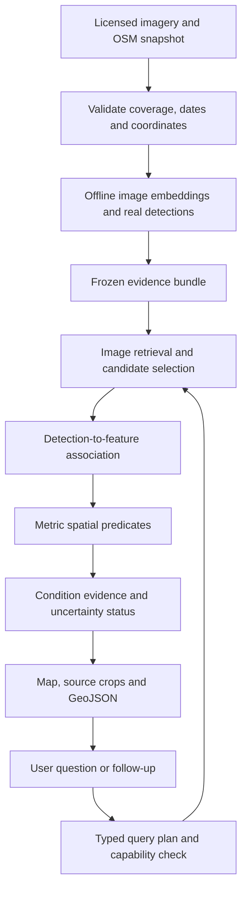

# TerraLens: Multimodal Infrastructure Search with Verifiable Spatial Evidence

Research and implementation workflow for GEOAI 05. Prepared 9 October 2026.

**Recommended pipeline:** natural language -> validated query plan -> SkyCLIP image retrieval -> OWLv2 object evidence -> association with OSM features -> deterministic spatial checks -> interactive map, evidence cards and GeoJSON.

**Recommended eight-hour product:** a public application covering one small, real area, with live text search and spatial filtering over genuine, precomputed image embeddings and detections. Every result shows what was observed, which map feature was matched, and how the spatial condition was evaluated.

The core now has a locally exercised implementation over a tiny real NAIP/OSM corpus: model embeddings and detections, typed search, metric joins, conversational radius changes, an interactive aerial map and complete GeoJSON exports. See [implementation checks](docs/validation.md) for exact counts and limitations. Independent visual accuracy, hosted accounts and public deployment are still unverified. The broader design and eight-hour public-delivery target remain conditional on data quality, a small team, working accounts and adequate hosting resources.

## 1. What the problem actually requires

The challenge combines three different questions:

1. **Visual meaning:** does imagery contain the requested object or appearance?
2. **Object identity:** which geographic feature does that visual evidence belong to?
3. **Spatial relationship:** does that feature satisfy the requested relationship to another feature?

A tile containing a roof, solar panels and a drain does not prove that the panels are on that roof or that the roof is within 200 metres of the drain. The application must connect those pieces of evidence.

| Requirement | Implementation responsibility | Evidence shown to the user |
| --- | --- | --- |
| Natural-language input | Parse objects, attributes, relationships, distance, area and follow-up edits | Editable interpretation of the request |
| Open-model visual search | Compare text with aerial imagery embeddings | Ranked source tiles and model identity |
| Object grounding | Locate the requested object within an image | Pixel box or mask and original-resolution crop |
| Geographic extraction | Transform image coordinates into map coordinates | Geographic detection geometry and source transform |
| Spatial attribute joins | Associate detections with vector objects and execute predicates | Object IDs, attribute sources, distance or intersection |
| Conversational interaction | Maintain and safely update a structured plan | Changed filters and result differences |
| Export | Serialize results and provenance | Valid GeoJSON with meaningful geometry roles |

### Worked interpretation of the challenge's solar example

“Find commercial roofs with solar panels within 200 metres of open drainage” requires all of these:

- A building or roof candidate in the indexed area.
- Visual evidence for solar panels on that same building.
- Explicit evidence of commercial use. A large roof alone does not establish commercial use.
- A drainage feature with evidence supporting the requested open-drain category.
- A defined distance, measured here from the building footprint to the drain geometry.
- Acquisition dates, registration quality and coverage sufficient to interpret the result.

Missing commercial or drainage information makes the full query unresolved. The interface can offer a broader query, but must not silently remove those conditions.

For “unpaved roads intersecting cleared forest patches,” distinguish visible bare ground from proven forest clearing. A historical clearing claim requires suitable before-and-after evidence. Similarly, a bounding box overlapping a road is only coarse evidence of intersection; exact patch intersection needs a reliable patch boundary.

### Correction to the earlier GeoVerify-X proposal

Keep the conversational map, backend API, public deployment and explanations. Move pothole severity, repair budgets, team scheduling, OR-Tools and PDF reports to a later phase. They consume the deadline while leaving imagery retrieval and grounding unimplemented. A chatbot searching seeded pothole records would not satisfy this challenge's central AI requirement.

Use the product description **“Evidence-backed geospatial discovery”**. Government maintenance planning is a possible downstream application after the search engine works.

## 2. Research landscape and defensible gap

The following sources establish that remote-sensing language retrieval, grounding, conversational GIS and combined geospatial retrieval already exist. The final column is our interpretation of what the inspected work establishes for this particular product; it is not a claim that those systems could never support an extension.

| Primary source | Established contribution | Remaining question relevant to GeoVerify-X |
| --- | --- | --- |
| [SkyScript / SkyCLIP, AAAI 2024](https://arxiv.org/abs/2312.12856) | Remote-sensing image-text data and domain-adapted retrieval/classification | Does a retrieved scene contain the correct individual object satisfying every geographic clause? |
| [GeoChat, CVPR 2024](https://openaccess.thecvf.com/content/CVPR2024/papers/Kuckreja_GeoChat_Grounded_Large_Vision-Language_Model_for_Remote_Sensing_CVPR_2024_paper.pdf) | Remote-sensing conversation and visually grounded responses | How do image-coordinate results become traceable joins with independent map features? |
| [GeoGPT, journal publication 2024](https://doi.org/10.1016/j.jag.2024.103976) | Natural-language planning and execution of GIS tools | How is an inferred visual attribute established before running the GIS operation? |
| [GeoGround, 2024 preprint, revised 2025](https://arxiv.org/abs/2411.11904) | Remote-sensing grounding with horizontal boxes, oriented boxes and masks | How should grounding errors affect geographic association and relationship decisions? |
| [GeoPixel, ICML 2025](https://proceedings.mlr.press/v267/shabbir25a.html) | Pixel-grounded remote-sensing conversations and segmentation | What evidence connects a segmented image region to an external geographic entity? |
| [GeoViS, December 2025 preprint](https://arxiv.org/abs/2512.02715) | Progressive visual search for small targets and spatially complex grounding | How reliable are resulting metric joins when imagery and map features have positional error? |
| [GeoAgentic-RAG, 2026](https://doi.org/10.1016/j.jag.2026.105195) | Natural-language interpretation, semantic-spatial retrieval, vector/raster data and executable spatial analysis | Its reported terrain/population and vector experiments do not establish rooftop optical grounding followed by object-to-OSM identity checks |

**Working research gap:** evaluate whether explicit object association, per-condition evidence and uncertainty-aware spatial decisions reduce confidently wrong answers to compound visual-spatial queries.

This is narrower and more defensible than claiming that “LLMs cannot do GIS” or that combining CLIP, a map and PostGIS is new. The literature review is targeted, not exhaustive. Scientific novelty remains provisional until a broader review and controlled experiments support it.

### Three failure modes worth solving

1. **Cross-object confusion:** panels on building A are accidentally used as evidence for nearby commercial building B.
2. **False geographic precision:** an uncertain detection or displaced map feature is presented as an exact 199-metre match.
3. **Unsupported completeness:** top-ranked tiles, missing OSM tags or detector non-detections are treated as proof about all objects in a municipality.

## 3. Innovations ranked by value and feasibility

| Priority | Proposed innovation | User value | Eight-hour decision | Evaluation |
| --- | --- | --- | --- | --- |
| 1 | Evidence chain for every condition and object association | A reviewer can inspect why a result appeared | Core feature | Incorrect cross-object matches; object precision/recall; evidence completeness |
| 2 | Typed conversational edits | “Change 200 m to 100 m” preserves all other conditions | Core feature | Unintended condition changes; correct result-set changes |
| 3 | Coverage and missing-evidence reporting | Distinguishes absent results from unavailable evidence | Core feature | Unsupported claims on missing-layer, unseen-class and boundary cases |
| 4 | Distance sensitivity and abstention | Identifies matches that depend on small coordinate shifts | Add after core works | False confident decisions versus fraction of cases answered |
| 5 | Multiple image scales with spatial pruning | Preserves small-object detail and reduces unnecessary work | Limited implementation | Recall and latency against whole-tile retrieval |
| 6 | Human correction with reproducible reruns | Supports review and captures useful labels | Later | Correction effort and improvement on a separate test set |
| 7 | Temporal change confirmation | Distinguishes visible appearance from an observed change | Later; needs paired imagery | Change precision/recall with temporal ground truth |
| 8 | Learned calibration or conformal prediction | Could provide empirically supported risk control | Research phase | Calibration and coverage under geographic distribution shift |

The first three are useful engineering differentiation. None is automatically a new scientific method. The strongest research hypothesis is that an auditable evidence chain plus selective abstention improves reliability at a measurable coverage cost.

## 4. Selected technology and deployment architecture

| Component | Selected default | Reason and boundary |
| --- | --- | --- |
| UI | React, TypeScript, Vite, Tailwind, MapLibre GL JS | Chat, map, evidence inspection and export in one screen |
| Backend | FastAPI with Pydantic | Typed contracts and small, explicit execution functions |
| Language interpretation | Backend OpenAI API with Structured Outputs | Produce a constrained plan; never use it as the image detector or distance calculator |
| Image/text retrieval | SkyCLIP ViT-B/32 through a compatible OpenCLIP setup | Remote-sensing candidate; smaller integration target than a large conversational VLM |
| Grounding | `google/owlv2-base-patch16-ensemble` through Transformers | Text-conditioned object boxes; validate aerial performance before committing |
| Small search index | Normalized NumPy embedding matrix | Enough for the initial corpus; no separate vector database |
| Image coordinates | Rasterio and pyproj | Preserve raster transforms and CRS conversions |
| Spatial execution | GeoPandas and Shapely, using a local metric CRS | Straightforward proximity, intersection and attribute joins |
| Data | Frozen imagery, vectors, model outputs and a versioned manifest | Reproducible and independent of live data-service availability during judging |
| Public hosting | Vercel frontend and Render FastAPI service | Matches the original deployment direction |
| Persistent mutable records | Supabase only if saved reviews/history are included | Not required for the initial read-only discovery application |

The [SkyScript repository](https://github.com/wangzhecheng/SkyScript) publishes a SkyCLIP ViT-B/32 checkpoint. [OpenCLIP](https://github.com/mlfoundations/open_clip) documents separate image/text encoding and normalized similarity. Give checkpoint loading and a small sanity evaluation a fixed time budget. If compatibility fails, use one pinned generic OpenCLIP ViT-B/32 checkpoint and regenerate both sides of the index. A remote-sensing model is the initial choice, not an assumed accuracy winner.

[OWLv2's model card](https://huggingface.co/google/owlv2-base-patch16-ensemble) and [Transformers documentation](https://huggingface.co/docs/transformers/model_doc/owlv2) support text-conditioned detection. They do not establish solar-panel or unpaved-road accuracy in our data. If it fails the initial local check, test [Grounding DINO tiny through Transformers](https://huggingface.co/docs/transformers/model_doc/grounding-dino) as the sole alternative. Keep one detector in the delivered pipeline. Avoid adding SAM, another large VLM or model training during the MVP.



**Inference split:** image encoding and supported-class grounding happen during preparation. Text encoding, query interpretation, ranking, joins and conversational updates happen online. The interface states: “Precomputed model detections; live search and spatial filtering.” New visual concepts remain searchable at tile level, but require an inference worker before they can receive grounded object-level spatial answers.

This deliberately bounds the MVP. It is not unrestricted live grounding for arbitrary text. If hackathon rules specifically require per-request detector execution, add a provisioned inference worker and test it by Hour 2, or report that requirement as incomplete.

## 5. Data selection: resolve the largest risk first

### Default and fallback order

1. **Use organizer-supplied or already available municipal imagery first**, if it has usable coordinates, adequate resolution and documented permission. Use Pune only if such data actually exists.
2. **Otherwise select a small US municipal area using NAIP imagery through Planetary Computer**, paired with the actual OSM extract for that area. Fetch a small raster window, not an entire regional archive. Microsoft's [NAIP example](https://github.com/microsoft/PlanetaryComputerExamples/blob/main/datasets/naip/naip-example.ipynb) demonstrates spatial/date selection and cloud raster access. The [NAIP catalog](https://developers.google.com/earth-engine/datasets/catalog/USDA_NAIP_DOQQ) documents variable resolutions and attribution. Inspect the selected asset's metadata; a catalog description is not proof that a particular tile meets our needs.
3. **Use SpaceNet 1 as the reference-aligned fallback if a small subset is readily available.** It provides Rio imagery and building footprints. Its published full training download is 23 GB, so do not make downloading the archive a prerequisite. It does not supply the solar, commercial-use, open-drain or pothole labels needed to validate those claims. Its page specifies CC BY-SA 4.0. [SpaceNet 1](https://spacenet.ai/spacenet-buildings-dataset-v1/)
4. **Use SkyScript primarily as a model and retrieval reference.** Its image metadata includes geographic bounds and capture time, but scattered focus-object crops are not automatically a continuous municipal atlas. Preserve those metadata if using a subset. Check underlying imagery-source terms separately from the repository's software licence. [SkyScript data documentation](https://github.com/wangzhecheng/SkyScript)

**Implementation update (9 October 2026):** the initial real-data diagnostic sample is a 600-metre-square Sacramento / Land Park crop, not Pune. The selected NAIP item is `ca_m_3812129_sw_10_060_20220621`: 1,000 × 1,000 RGB pixels, 0.6-metre ground sampling distance, EPSG:26910, acquired 21 June 2022. Actual OSM roads and buildings were extracted with a 525-metre margin on 9 October 2026. The extract contains 1,079 road ways and 2,972 building ways; the queried waterway layer is empty and is not configured as usable drainage evidence. These dates are different epochs and must remain visible. See [dataset notes](docs/datasets.md) and [runnable pipeline](pipeline/README.md).

### Initial corpus budget

- One bounded area; begin with a tiny diagnostic bundle (the current sample uses four overlapping 640-pixel windows), then expand toward 50–200 tiles only after checking model quality and runtime cost.
- One imagery acquisition period where possible, with tile-level dates retained.
- Two reliably observable concepts initially; expand to three to five only after validation.
- Buildings plus roads as the minimum vector layers; drainage/waterways only where populated and understood.
- Maximum supported distance initially 500 metres. Fetch reference vectors outside the displayed area by at least that distance, plus the chosen positional tolerance.
- Include normal scenes, hard negatives, empty tiles and objects near tile boundaries.

OSM vectors are analysis inputs; rendered basemap tiles are a display service. Preserve OSM attribution and applicable data notices. Do not bulk-download the standard OSM tile service to build the imagery corpus. [OSM attribution](https://www.openstreetmap.org/copyright), [tile policy](https://operations.osmfoundation.org/policies/tiles/)

### Data gate: complete within 45 minutes

| Check | Pass condition | If it fails |
| --- | --- | --- |
| Access | Several actual image assets can be read and cropped | Switch source or geography |
| Registration | Known CRS/transform and plausible overlay at several landmarks | Repair metadata or exclude images |
| Observability | Requested target is distinguishable at original resolution | Change supported concept; do not invent detail |
| Vector coverage | Relevant local reference features exist | Narrow the query family and disclose missing layers |
| Provenance | Source, date or explicit unknown, terms and attribution recorded | Do not publish that asset until resolved |

**Model gate: complete by 90 minutes.** Produce one real embedding and grounded detections on representative positive and negative imagery. If loading or quality fails, test the single model fallback and reduce corpus size. This follows the 45-minute data gate and must pass before the public end-to-end milestone.

Resolution is a physical limit: a 2-metre object spans about 7 pixels in 0.3-metre imagery, but only 2 pixels in 1-metre imagery before any resizing. These are illustrative calculations, not detection guarantees. Larger arrays may be visible where individual panels are not. Pothole severity is outside this MVP.

If no usable real imagery is available, a synthetic or hand-annotated interface may demonstrate software wiring, but must be labelled accordingly and the visual-search requirement remains unfinished.

## 6. Offline preparation workflow

### A. Normalize and freeze source data

Read the source raster, select RGB bands in the correct order, preserve no-data masks, and save the original CRS and transform. Create manageable overlapping windows and preview images. Retain each window's offset and transform; resized thumbnails must never replace the coordinate reference for detections.

Validate vector geometries, retain original feature IDs/tags and record any geometry repairs. Keep an immutable source copy. Set a local projected CRS suitable for the selected area and its units. Do not blindly assign a new CRS to coordinates; reproject them.

### B. Build the retrieval index

Encode full tiles and, where time permits, building-focused or smaller overlapping crops. Normalize embeddings. For a text vector `q` and image vector `v_i`, use `score_i = dot(normalize(q), normalize(v_i))`.

Keep the exact checkpoint, tokenizer, image preprocessing and index version together. Text and image encoders must come from the same compatible model. Do not combine SkyCLIP image vectors with another model's text vectors.

At 1,000 vectors with 512 float32 values, the matrix is approximately 2 MB; model weights and runtime memory will dominate. Measure the actual embedding dimension and host memory rather than assuming that the whole application is this small.

### C. Produce actual object evidence

Run the selected grounding model on original-resolution windows for each supported concept. Save the prompt, raw score, pixel box, checkpoint, image checksum and inference timestamp. Tune class-specific screening thresholds on development examples; no universal “0.3 means correct” assumption.

Use overlapping windows for edge objects, then deduplicate detections from the same image epoch using geographic overlap and class agreement. Preserve provenance when merging. Do not automatically merge detections from different dates into a single timeless object.

Ground-truth footprints, human-drawn boxes and model detections are separate evidence types. A SpaceNet label or OSM footprint must not be presented as an AI-generated detection.

### D. Convert pixels to geography

First establish whether detector postprocessing already returns boxes in the original window's pixel coordinates. Undo resizing/letterboxing only if it does not. Transform all four corners using exactly one route: window-local coordinates with the window transform, or parent-image coordinates with window offsets added once and the parent transform. Applying window offsets and then a window transform would shift detections twice.

A rotated raster can produce a quadrilateral rather than an axis-aligned map rectangle. Preserve this geometry; use its envelope only as a display bounding box. Transform into the analysis CRS for distances and into longitude/latitude for export. [Rasterio transforms](https://rasterio.readthedocs.io/en/stable/topics/transforms.html), [window transforms](https://rasterio.readthedocs.io/en/stable/topics/windowed-rw.html)

For imagery with only geographic bounds, use a bounds-derived transform only after verifying the image's orientation and coordinate mapping. Record its limitations; bounds alone do not establish precise registration.

### E. Associate observations with map entities

For rooftop panels, identify candidate building footprints overlapping the panel detection. A starting development rule can require the detection centre inside a building and at least 50% detection-area overlap with that building, plus a unique association. This is an initial heuristic to validate, not a published guarantee. Nearby roofs, overhangs, displacement and broad boxes require an ambiguous state.

Keep detection geometry, associated building footprint and reference-feature geometry separate. A successful association does not turn the detector box into a measured roof boundary. Only unambiguous associations enter strict compound matches; ambiguous observations remain inspectable candidates.

### Required artifacts

| Artifact | Required content |
| --- | --- |
| `manifest.json` | Dataset version, AOI, coverage geometry, dates, CRS, supported concepts, model identities, data licences |
| `tiles.json` | Tile ID, source ID, checksum, size, transform, resolution, acquisition date, crop/preview paths |
| `embeddings.npy` | Normalized vectors with a stable tile/crop row mapping |
| `detections.geojson` | Geographic detections, original pixel boxes, scores, prompts, model version, evidence type |
| `vectors.gpkg` | Reference layers, OSM IDs/tags/version where available, extraction timestamp |
| `associations.json` | Detection-to-feature links, rule/version, overlap measurements and ambiguity |
| `capabilities.json` | Supported concepts/relations, observed coverage, unavailable attributes and operational limits |
| `evaluation.json` | Frozen development/test definitions and measured results once available |

## 7. Online query workflow

### Step 1: Parse language into a typed plan

Send the question, previous validated plan and capability manifest to the language model. Request a schema-constrained response. Still validate semantics, entity names and numerical bounds on the server; schema validity does not make an interpretation correct. Handle refusal, incomplete output and timeout explicitly. [OpenAI Structured Outputs](https://developers.openai.com/api/docs/guides/structured-outputs)

Illustrative plan for the solar example; this is not a claim that the eventual data supports every condition:

```json
{
  "schema_version": "1",
  "aoi_id": "selected_demo_area",
  "dataset_version": "frozen_demo_v1",
  "mode": "catalog_scan",
  "subject": "building",
  "visual": {
    "concept": "rooftop_solar_panels",
    "association": "same_building"
  },
  "attributes": [
    {"field": "building_use", "operator": "equals", "value": "commercial"}
  ],
  "relation": {
    "operator": "within_distance",
    "reference": "open_drain",
    "distance_m": 200,
    "measure_from": "building_footprint"
  },
  "unknown_policy": "separate",
  "page_size": 50
}
```

The server owns the actual layer IDs, attribute mappings, CRS and operation implementations. Allow only declared operations: `within_distance`, `intersects`, `within`, and a small set of attribute comparisons. Reject arbitrary SQL, Python, layer paths and model-generated coordinates.

Resolve ambiguous “near” into a visible distance choice. Resolve an unspecified area against the selected map area. A follow-up like “make that 100 metres” becomes a validated patch to `relation.distance_m`; preserve the dataset, subject, attributes and all other conditions. Show the change before explaining the new results.

### Step 2: Check capabilities and evidence availability

- Verify that the requested area intersects indexed imagery.
- Verify that the concept has grounded evidence or an available live inference worker.
- Verify required reference layers and attribute mappings.
- Keep unknown dates, incomplete coverage and unavailable attributes visible.
- Return a specific clarification or unsupported condition when needed; never silently substitute a broader class.

For example, a `waterway=drain` record is relevant drainage evidence, but tunnel/covered attributes and local tagging quality affect an “open” claim. Retain those qualifications. Commercial-use evidence must use a declared tag/source mapping; being inside a commercial land-use polygon is weaker than a specific building-use record. [OSM drain documentation](https://wiki.openstreetmap.org/wiki/Tag:waterway%3Ddrain)

### Step 3: Select candidates without losing the query's meaning

Use two explicit modes:

| Mode | Execution | Allowed claim |
| --- | --- | --- |
| Explore | Rank imagery/crops; inspect a bounded top-k set | “Top visual candidates among indexed tiles” |
| Catalog scan | Evaluate all cached detections for supported concepts in the covered area; rank and paginate after filtering | “All matching records in this processed evidence catalog” |

Neither mode proves that every real-world object was detected. Return `tiles_considered`, `tiles_processed`, `objects_evaluated`, `coverage`, `truncated` and the selected mode. Page size must not silently become an evaluation limit.

Spatial pruning is useful only when it is conservative: keep all potentially qualifying objects, including necessary border margins. If association is incomplete, aggressive footprint-only pruning can lose unmapped candidates; retain a visual exploration path and expose that coverage limitation.

### Step 4: Execute geographic predicates

For proximity, calculate the minimum distance between the explicitly selected subject geometry and reference geometry. Use both geometries in the same suitable metric CRS. `distance <= radius` determines nominal inclusion; draw a buffer for explanation, not as a replacement for well-defined geometry semantics. [Shapely dwithin](https://shapely.readthedocs.io/en/stable/reference/shapely.dwithin.html)

For multiple references, retain all qualifying reference IDs or return their count plus an identified nearest witness. A nearest-neighbour lookup alone cannot enumerate every feature within the radius. Spatial indexes accelerate candidate selection; exact predicates perform the final checks.

Define `intersects` to include boundary contact. If a user means a road passes through a patch interior, use the appropriate stricter rule and state it. Bounding-box overlap is insufficient for an exact patch-intersection claim. Containment likewise needs an explicit boundary rule.

If migrating to PostGIS, implement the same validated operations with parameterized queries and spatial indexes. Geometry distances use CRS units; `ST_DWithin` on geography uses metres. Never call `buffer(200)` on longitude/latitude coordinates and interpret it as 200 metres. [PostGIS ST_DWithin](https://postgis.net/docs/ST_DWithin.html), [Supabase PostGIS](https://supabase.com/docs/guides/database/extensions/postgis)

### Step 5: Build results from executed evidence

Construct result cards and an explanation from the execution records. Use deterministic templates initially. An optional language-model summary may explain those records but cannot add IDs, scores, distances or observations.

Each result contains the source crop, grounded object, associated feature, all condition decisions, measured relation, dates and coverage limitations. Explain exclusions and unknowns as well as included matches.

## 8. Evidence states and uncertainty

Keep these fields separate:

| Evidence dimension | Example value | Meaning |
| --- | --- | --- |
| Retrieval score | Raw cosine similarity | Ranking signal, not a probability |
| Detection score | Raw model score | Model output requiring local validation |
| Visual decision | Candidate / supported / uncertain | Based on the declared screening and review policy |
| Attribute decision | Present / conflicting / unknown | Source tags or another declared record |
| Association | Unique / ambiguous / absent | Whether image evidence maps to a particular feature |
| Spatial decision | Pass / fail / boundary-sensitive / unknown | Result on supplied geometries and assumptions |
| Review status | Not reviewed / confirmed / rejected | Human judgement kept separate from model output |

For each required clause, use `pass`, `fail` or `unknown`. A result is eligible for the strict matches list only when all required clauses pass. A definite failed clause excludes it; unresolved clauses produce a separate uncertain candidate. “Pass” remains conditional on the evidence and selected policy, not a certification of real-world truth.

Missing OSM tags are not negative evidence. Detector non-detection is not proof that panels are absent. “No supported matches” must not become “there are no such objects.” Historical imagery combined with a recent vector extract must not be described as a current observation.

### Implementable distance sensitivity

Let `d` be the measured distance, `r` the requested radius, and `e_subject`, `e_reference` positional allowances in metres. Define `e = e_subject + e_reference` and the illustrative interval:

```text
d_low  = max(0, d - e)
d_high = d + e

stable_within:  d_high <= r
stable_outside: d_low > r
boundary_sensitive: otherwise
```

These become defensible geometric bounds only if the input allowances actually bound the positional errors of the corresponding shapes. If allowances are user-selected or heuristic, label the output **sensitivity analysis under assumed positional allowances**. Do not call it a calibrated confidence interval.

For example, a nominal 198-metre distance with a combined assumed 5-metre allowance straddles a 200-metre threshold. Those numbers are illustrative. In the real application, show the nominal distance and assumption, and keep visual identity uncertainty separate. A missing error estimate cannot be replaced by a fabricated certainty score.

Distance sensitivity does not solve uncertain object identity, missing drains, unreliable attributes or temporal changes. Those require their own evidence states.

## 9. API, export and interface contract

### Minimal endpoints

| Endpoint | Purpose |
| --- | --- |
| `GET /health` | Process liveness |
| `GET /ready` | Dataset loaded, versions compatible, text encoder ready |
| `GET /capabilities` | AOI, layers, concepts, dates, modes and limits |
| `POST /query` | Parse or refine a plan and return execution results |
| `GET /evidence/{id}` | Source imagery, object geometry and provenance |
| `POST /export` | Re-execute a validated plan/version and stream GeoJSON |

Responses include the plan and dataset version, stable evidence IDs, per-stage timings, matches, uncertain candidates, coverage and truncation. Cache keys include the canonical plan, dataset, checkpoint and threshold versions. Do not reuse a response after changing any of those inputs.

Use a read-only, reproducible demo first: immutable artifacts are bundled or fetched from durable object storage; query results and exports are generated on demand. Session history can stay in browser memory. If persistent reviews or shared saved searches are introduced, store them in a real database; do not promise persistence from an ephemeral backend filesystem.

### GeoJSON contract

Export a FeatureCollection in WGS84 longitude/latitude order. The primary feature geometry represents the returned entity, such as its mapped building footprint; if only a detection envelope exists, label that geometry role explicitly. Include feature IDs, a geographic bounding box, source/model references, dates, attribute evidence, association status, executed predicate and measured distance in properties. [RFC 7946](https://datatracker.ietf.org/doc/html/rfc7946)

The UI should offer matches-only and matches-plus-uncertain export modes. Preserve that choice and coverage metadata. Include related detection/reference geometries as separately identified features when needed, rather than conflating them with the result geometry. Stream exports so downloading does not depend on an ephemeral saved file.

### One-screen user flow

1. A chat field with examples drawn from the actual capability manifest.
2. A visible interpretation of object, area, date and relationship.
3. A map showing imagery coverage, detections, reference features and matching entities as distinct layers.
4. A result list with source crops and separate evidence/relationship indicators.
5. An evidence drawer showing object association, dates, distance and limitations.
6. A follow-up that changes one condition and displays added/removed results.
7. GeoJSON download with the same conditions and dataset version.

Always include the geographic coordinates or a copyable location for a selected match. Keep source attributions visible. An unavailable basemap must not prevent inspecting evidence or downloading results.

### Suggested implementation layout

```text
frontend/src/       Map, chat, result cards, evidence drawer, export
backend/app/        API, schemas, parser, retrieval, spatial executor, evidence
pipeline/           Prepare imagery, embed, ground, associate, validate bundle
data/               Frozen manifest and small permitted demo artifacts
eval/               Development cases, held-out cases, metric reports
```

Separate heavy offline dependencies from the online backend where practical. Pin versions that actually pass the first model-loading test; this document does not assert a tested dependency lockfile.

## 10. Deployment workflow and operational limits

Deploy the smallest real end-to-end slice early: a few actual tiles, one supported object type, one spatial relationship and a downloadable result. A landing page and healthy API alone are not a deployed GeoAI demo.

| Stage | Action | Verification |
| --- | --- | --- |
| First deployment | React on Vercel; FastAPI on Render; frozen small artifact bundle | Public frontend and ready endpoint respond |
| First real query | Load compatible text encoder, embeddings and actual detections | Typed prompt returns a real crop and geographic evidence |
| Spatial integration | Run one supported metric relationship | Displayed distance agrees with independently checked geometry |
| Release candidate | Freeze data/model/threshold versions | Fresh browser session completes query, refinement and export |

[Render supports FastAPI deployment](https://render.com/docs/deploy-fastapi). Its [free-service documentation](https://render.com/docs/free) describes idle spin-down after 15 minutes, roughly one-minute wake-up and non-persistent runtime filesystem changes. Size an always-on backend from measured peak memory if available; do not assume a free instance can load the chosen text encoder. No paid service is provisioned by this plan.

The backend may load both model towers unless explicitly reduced to a text-only serving path. Benchmark actual cold start, peak memory and warm-query latency in Hour 1. Keep image grounding offline for the default deployment. Do not put heavyweight inference into Vercel frontend functions; [function limits](https://vercel.com/docs/functions/limitations) apply independently of successful static-site deployment.

Keep API credentials only in backend configuration. Limit request length, AOI size, distance and result count; set timeouts and rate limits. If using two origins, configure the exact frontend origin for CORS. Avoid live OSM downloads and new imagery/model downloads in the interactive request path.

If the text model does not fit the selected host, reduce the model choice and regenerate embeddings, or provision adequate backend capacity. A fixed prompt catalogue is a disclosed degraded mode, not equivalent to unrestricted text-image search. If a language API fails, an explicit form or documented template parser can preserve supported spatial operations while general language interpretation is unavailable.

Supabase/PostGIS becomes valuable for growing datasets, concurrent writes, saved reviews and durable shared queries. It is an extension point rather than a prerequisite for 200 read-only tiles. If the two-service deployment causes avoidable integration trouble, serving the built frontend from the FastAPI service is the fallback; retain a single public URL and verify the same user journey.

## 11. Eight-hour execution plan

Assume three parallel roles: **data/vision**, **backend/spatial**, and **frontend/deployment**. With one developer, reduce the corpus and feature count further; do not keep the same promises.

| Time | Data/vision | Backend/spatial | Frontend/deployment | Exit gate |
| --- | --- | --- | --- | --- |
| 0:00–0:45 | Pass data gate; inspect target visibility | Define plan/evidence schemas; one real metric predicate | Scaffold map and deploy services | Real registered imagery and usable vectors selected |
| 0:45–1:30 | Load models; check representative positives and hard negatives; build tiny bundle | Load evidence and retrieval; expose readiness and query API | Display genuine crop and geometry | One real end-to-end query works |
| 1:30–2:00 | Generate initial embeddings/detections | Connect constrained parser and export | Test public frontend-to-backend flow | Public URL supports a real visual-spatial query |
| 2:00–3:00 | Expand only the validated corpus/concepts | Implement associations, joins and unknown handling | Separate map layers and evidence cards | Correct object identity and spatial measurement |
| 3:00–4:00 | Deduplicate edges; freeze data versions | Implement query patches and catalog/explore modes | Follow-ups, coverage display and exports | Core challenge workflow is complete |
| 4:00–5:00 | Review development errors | Add sensitivity states if feasible | Explain ambiguous and unsupported requests | Evidence display handles difficult cases honestly |
| 5:00–6:00 | Run held-out visual and relation cases | Record metrics, timings and failure paths | Fix usability and public integration issues | Measurements exist; thresholds frozen |
| 6:00–7:00 | Inspect remaining errors without retuning on test set | Reliability fixes and restart checks | Full public-browser rehearsal | Fresh session can complete the demo |
| 7:00–8:00 | Preserve evidence bundle and reports | Freeze release; no architecture changes | Record backup demo and rehearse judging | Working public URL plus clear limitations |

### Cut rules

- At 45 minutes: change the geography if imagery is unavailable; do not keep waiting for Pune data.
- At 90 minutes: stop exploring additional model families. Use the functioning validated choice and shrink scope.
- At Hour 2: if grounding is still absent, the central requirement is at risk. Stop polishing and address it; an OSM-only response is not a substitute.
- At Hour 4: stop adding capabilities. Retain retrieval, real grounding, spatial joins, evidence, follow-ups and GeoJSON.
- At Hour 6: freeze features and use the remaining time for correctness and deployed verification.

## 12. Evaluation and acceptance criteria

### Small, honest evaluation set

Create approximately 10 development queries and 20 held-out queries spanning supported concepts, spatial predicates, missing evidence and follow-ups. Independently annotate a manageable set of roughly 50–100 object instances across those scenes, including hard negatives. These are hackathon-scale diagnostic targets, not enough to prove municipality-wide reliability.

Split by non-overlapping geographic blocks or source scenes, keeping overlapping crops and the same object together. Use development cases to choose prompts and thresholds; freeze them before the held-out run. Check before claiming any benchmark is outside the pretrained model's training data. OSM tags used to construct training captions are not independent visual ground truth.

Separate evaluation tracks:

1. **Visual:** retrieve and locate independently labelled objects; record classification/grounding errors.
2. **Geometry:** supply known geometries to isolate transformation, distance and predicate correctness.
3. **End to end:** compare final object IDs satisfying all clauses against reviewed reference answers.
4. **Conversation:** verify that refinements change only the intended fields and results.

| Measure | What to report |
| --- | --- |
| Retrieval Recall@k | Relevant annotated tiles found in the top k; do not call this object accuracy |
| Grounding | Precision/recall and box IoU or mask metric where those labels exist |
| Compound-query quality | Object-level precision/recall after every required clause |
| Association errors | Cases where visual evidence is attached to the wrong feature |
| Spatial correctness | Agreement on known geometry fixtures and reviewed relationships |
| Abstention | Uncertain/unsupported rate alongside errors among answered cases |
| Plan correctness | Correct entities, attributes, predicates, units and follow-up changes |
| Public latency | Cold-start and warm p50/p95 separately, with host and corpus size |
| Export correctness | Valid geometry, longitude/latitude order, matching IDs and provenance |

Use point estimates and sample counts honestly; do not report a small test set as a production guarantee. If development changes follow held-out failures, disclose that the set was used for debugging and obtain a fresh test set for a new unbiased claim.

### Baselines and ablations

Run the first three on the same small query set; treat the last two as additions if time permits:

- **B0: vector-only filtering.** Shows which visual requests cannot be answered from tags.
- **B1: image retrieval only.** Shows co-occurrence and localization failures.
- **B2: retrieval + grounding + explicit object association + exact joins.** The proposed core, with the standard missing-evidence policy and nominal distance decisions.
- **B3: B2 + distance-sensitivity handling.** Keep the same queries, candidates and missing-evidence policy; report confident-error reduction alongside lost answer coverage. This isolates the effect of sensitivity handling.
- **B4: full plan regeneration versus validated conversational patches.** Measure unintended changes.

Do not compare a tile-retrieval ranking metric directly with an object-detection metric and claim one model is superior. Where evaluating cross-object errors, also compare grounding with and without the explicit association check.

### Required adversarial cases

- Panels and a commercial building in the same tile, but on different roofs.
- A building just inside, at and just outside the requested radius.
- Longitude/latitude axis reversal and a known pixel-to-map transformation.
- Missing commercial tag; missing drain layer; unsupported visual concept.
- Duplicate object crossing a tile edge; detection overlapping two buildings.
- Subject at the AOI border with a qualifying reference outside the displayed AOI.
- Old imagery with a newer map feature; unknown acquisition date.
- Negative wording such as “without panels,” where non-detection is insufficient.
- A follow-up changing only distance, with all other filters preserved.
- Top-k truncation and pagination that could otherwise be mistaken for “all.”

### Definition of done

- A fresh browser session can open the public URL and complete search, refinement, inspection and export.
- At least two supported query families combine actual visual-model evidence with actual vector spatial checks.
- Every returned object exposes its crop, geometry role, source IDs, evidence decisions and acquisition/snapshot dates or explicit unknowns.
- At least one unknown/unsupported case behaves correctly; zero results do not become a claim of absence.
- Known geometry fixtures pass; exported GeoJSON reproduces the map's feature IDs and locations.
- Real inference, human annotations, reference labels and synthetic test fixtures are distinguishable.
- A small evaluation report includes failures and denominators. No unmeasured accuracy or latency claims appear in the pitch.
- The deployed app survives a backend restart with its immutable corpus intact and no credential exposure.

Warm p95 under five seconds for the small cached corpus is a useful engineering target, not an observed result. Record the achieved value and any slower language-model or hosting contribution.

## 13. Judge-facing demonstration

Select examples only after the data and visual checks pass. Candidate families include buildings close to roads, visible roof features near mapped waterways, and larger rooftop solar arrays near a supported reference layer. “Commercial” and “open drainage” enter the demo only when their evidence exists.

1. Show the municipality, imagery date, covered area and supported concepts.
2. Enter a natural-language visual-spatial request.
3. Open one result: show its original crop, grounded object, linked map feature and measured relationship.
4. Change the distance in conversation and show the condition and result changes.
5. Inspect an uncertain case or unsupported request to demonstrate the evidence boundary.
6. Download GeoJSON and open it as a separate map layer to verify the export.

Suggested positioning:

> GeoVerify-X turns a question into an inspectable geographic search. It uses an open vision-language model to find visual candidates, connects them to mapped objects, and checks spatial conditions with deterministic geometry. Each result includes the source image, the evidence for each condition and the limits of what the data can establish.

Do not claim first-of-its-kind research, municipality-wide completeness, real-time imagery, unrestricted live grounding or government readiness. The strongest delivery is a coherent, tested visual-to-spatial workflow whose answers can be checked.

## 14. After the hackathon

The next priorities are broader geographic evaluation, a live grounding worker, richer masks where exact object boundaries matter, better image/map registration and independently validated attribute sources. Add durable reviewer feedback and PostGIS when usage requires them.

Only after retrieval and relationship reliability are measured should the project expand into temporal change alerts, maintenance prioritization or repair optimization. Those applications need additional data and objectives; they do not follow automatically from a spatial match.
